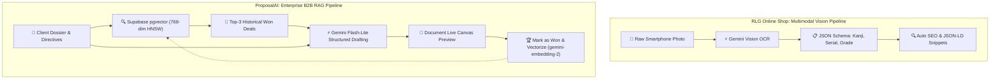

# 🌟 RLG Developer Portfolio & Interactive Architectural Workspace

<p align="center">
  
</p>

<p align="center">
  <strong>Senior Frontend Engineer & Creative UI Architect Portfolio</strong><br />
  A dual-surface developer portfolio featuring a modern light Bento grid UI and an immersive architectural workspace with interactive multi-device simulators, live proposal studios, slide deck talk tracks, and autonomous AI automation pipelines.
</p>

<p align="center">
  <a href="https://rlgonlineshop.com" target="_blank">
    
  </a>
  <a href="https://proposal-ai.vercel.app" target="_blank">
    
  </a>
  <a href="#-tech-stack--tooling">
    
  </a>
  <a href="#-tech-stack--tooling">
    
  </a>
  <a href="#-tech-stack--tooling">
    
  </a>
  <a href="#-tech-stack--tooling">
    
  </a>
  <a href="#-tech-stack--tooling">
    
  </a>
</p>

---

## 📑 Table of Contents

1. [Architectural Concept & Dual-Surface Experience](#-architectural-concept--dual-surface-experience)
2. [Flagship Project 1: RLG Online Shop (E-Commerce Monorepo)](#-flagship-project-1-rlg-online-shop-e-commerce-monorepo)
3. [Flagship Project 2: ProposalAI (Enterprise B2B AI Proposal Generator)](#-flagship-project-2-proposalai-enterprise-b2b-ai-proposal-generator)
4. [Inner Project Workspace & Dynamic Theme Switching](#-inner-project-workspace--dynamic-theme-switching)
5. [Interactive Demos & Live Canvas Studios](#-interactive-demos--live-canvas-studios)
6. [Presentation Deck System (NotebookLM Style)](#-presentation-deck-system-notebooklm-style)
7. [AI Pipelines Deep Dive (Vision OCR vs. pgvector RAG)](#-ai-pipelines-deep-dive-vision-ocr-vs-pgvector-rag)
8. [Cloud Infrastructure & Deployment Topology (Railway & Vercel)](#-cloud-infrastructure--deployment-topology-railway--vercel)
9. [Codebase Architecture & Directory Structure](#-codebase-architecture--directory-structure)
10. [Reactive State Management (Pinia)](#-reactive-state-management-pinia)
11. [Local Development & Setup Guide](#-local-development--setup-guide)
12. [Developer Bio & Contact](#-developer-bio--contact)

---

## 🏛 Architectural Concept & Dual-Surface Experience

This portfolio is built on a **Dual-Surface UI Paradigm** engineered to solve the traditional developer portfolio paradox: high-level hiring managers want clean, legible overviews and quick metrics, while engineering leads, staff architects, and tech interviewers demand deep dives into architecture, live simulated applications, code quality, and infrastructure topology.

```
┌────────────────────────────────────────────────────────────────────────┐
│                        OUTER PORTFOLIO (Light Bento)                   │
│   • Modern Bento Grid (#f8fafc / #ffffff)                              │
│   • Developer Bio & Availability                                       │
│   • 6-Category Skills, Tooling & Infrastructure Matrix                 │
│   • Two Flagship Projects: RLG Online Shop & ProposalAI                │
└───────────────────────────────────┬────────────────────────────────────┘
                                    │ Click "Explore Project Workspace"
                                    ▼
┌────────────────────────────────────────────────────────────────────────┐
│                   INNER PROJECT WORKSPACE (Multi-Theme SaaS)           │
│   • RLG Online Shop: Dark Cybernetic Shell (#090d16 / #0f172a)         │
│   • ProposalAI: Light Enterprise B2B Theme (#f8fafc / #ffffff / Teal)  │
│   • Seamless Project Switcher in Top Navigation Bar                    │
│   • 7 Dedicated Modules: Overview | Deck | Demos | Tech | AI | Arch | Deploy
│   • Working Live Simulators: 13-Section Storefront & Proposal Canvas   │
└────────────────────────────────────────────────────────────────────────┘
```

---

## 🛍️ Flagship Project 1: RLG Online Shop (E-Commerce Monorepo)

- **Domain:** Production at [rlgonlineshop.com](https://rlgonlineshop.com)
- **Tagline:** Full-Stack Monorepo Featuring Multimodal AI Automation
- **Aesthetic:** Dark Cybernetic Shell (`#090d16` to `#0f172a`, purple & cyan glows).
- **Core Stack:** Laravel 11, Vue 3, Inertia.js, MySQL, Redis, Gemini Vision OCR, Railway Cloud, Namecheap DNS.
- **Key Capabilities:**
  - **Multimodal AI Vision Intake:** Parses Japanese card serial numbers, expansion sets, and centering condition grades in < 1.5s directly from raw smartphone photos.
  - **Automated SEO & Schema Generator:** Automatically generates search-optimized titles, deduplicated slugs, and `schema.org/Product` JSON-LD schemas.
  - **13-Section Authentic Storefront:** Complete Japanese collectibles e-commerce site with live card grids, dynamic bundles, and floating *"Ask Aiko AI"* assistant.
  - **Cloud Infrastructure:** Multi-container deployment on Railway with Nixpacks, Redis queue workers, and custom apex DNS routing via Namecheap.

---

## 💼 Flagship Project 2: ProposalAI (Enterprise B2B AI Proposal Generator)

- **Domain:** Production-ready at [proposal-ai.vercel.app](https://proposal-ai.vercel.app)
- **Tagline:** Production-grade multi-tenant B2B platform automating the drafting, financial modeling, and dispatch of high-conversion sales proposals using Gemini and Supabase pgvector.
- **Aesthetic:** Light Enterprise B2B SaaS Theme (`#f8fafc` background, pure white cards `#ffffff`, subtle slate borders `#e2e8f0`, teal `#0d9488` and emerald `#10b981` accents).
- **Core Stack:** Laravel 11 Clean Architecture, Vue 3.5, Inertia.js v3, PostgreSQL 17 on Supabase, `pgvector` (768-dim HNSW index), Gemini Flash-Lite 3.5 & 2.5 Pro, Stripe Cashier, PayMongo Gateway, Vercel Edge Cloud.
- **Key Capabilities:**
  - **Context-Aware RAG with pgvector:** Queries the top-3 historically won enterprise proposals matching client industry and deal size via sub-15ms cosine similarity search.
  - **Sub-3.2s Generation Speed:** Fast streaming drafts using Gemini Flash-Lite with strict JSON schema response mode for executive summaries, milestone timelines, and deliverable catalogs.
  - **Deterministic Financial Ledger (Pinia):** Decoupled from LLM generation—strict decimal math computes quantity multipliers, volume discount curves, 12% VAT, and grand totals with zero hallucination risk.
  - **Self-Improving RAG Flywheel:** Sales reps click *"Mark as Won & Vectorize"* to chunk closed deals with `gemini-embedding-2` and index them into Supabase `won_pitches` table for future retrieval.
  - **Multi-Tenant Quota Gating:** Free tier (3/5 proposals used) with interactive warning indicator, plus Stripe Cashier and PayMongo upgrade modals for Pro ($49/mo) and Enterprise ($199/mo) plans.

---

## 🎨 Inner Project Workspace & Dynamic Theme Switching

The Inner Workspace shell (`WorkspaceShell.vue`) dynamically adapts its layout and aesthetics depending on the active project selected via the top bar switcher:

| Feature | RLG Online Shop | ProposalAI |
| :--- | :--- | :--- |
| **Theme Aesthetic** | Dark Cybernetic (`#090d16` / `#0f172a`) | Light Enterprise B2B (`#f8fafc` / `#ffffff`) |
| **Accent Colors** | Indigo (`#6366f1`) & Purple (`#a855f7`) | Deep Teal (`#0d9488`) & Emerald (`#10b981`) |
| **Top Status Badges** | `Production: rlgonlineshop.com 🟢`, `Railway`, `Namecheap` | `Vercel Deploy 🟢`, `Supabase pgvector`, `Stripe & PayMongo` |
| **AI Status Pill** | `AI Services: Online 🟢` | `AI Services Active 🟢` |
| **Demos View** | Multi-Device DeviceSimulator (Admin vs. Buyer Storefront) | Live Proposal Studio & Document Canvas |
| **Cloud Topology** | Railway Container Orchestration & Redis | Vercel Edge Serverless & Supabase Database |

---

## 💻 Interactive Demos & Live Canvas Studios

### 1. ProposalAI Live Studio (`ProposalAiDemo.vue`)
- **Column 1 (Live Proposal Builder & Canvas):**
  - **Preset Selector:** Toggle between Acme Corp (Enterprise SaaS), FinTech Global (AI Compliance), and OmniRetail (Inventory Sync).
  - **Client Intel & CRM Dossier:** Inputs for organization name, procurement email, and contact names.
  - **Catalog Deliverables:** Interactive line items with quantity counters, unit cost in USD, line discount percentage, and instant removal/addition.
  - **Pinia Real-Time Ledger:** Dynamic subtotal, volume discount curves, 12% standard enterprise VAT, and deterministic grand total.
  - **Strategic Directives Field:** Textarea with live character counter (1000 char maximum).
  - **Generation Trigger:** Button activating simulated Gemini streaming states.
- **Column 2 (Document Live Canvas & Draft Preview):**
  - **Shimmer Progress State:** Visual indicator displaying live Supabase pgvector retrieval and Gemini Flash-Lite drafting.
  - **Executive Summary:** Context-tailored narrative addressing client pain points and projected 6-month ROI.
  - **Milestone Timeline:** Visual node stepper diagram connecting Sprint 0 (Architecture Review) ➔ Phase 1 (Core Migration) ➔ Phase 2 (RAG Vectorization) ➔ Phase 3 (SLA Handover).
  - **Dynamic Pricing Table:** Formatted tabular ledger with item numbering, cost breakdown, and final totals.
  - **Mark as Won & Vectorize Button:** Triggers animated toast confirmation showing chunk embedding via `gemini-embedding-2` and Supabase pgvector table indexing.
- **Quota Warning & Upgrade Modal:** Real-time 3/5 quota usage bar with Stripe and PayMongo payment tabs.

### 2. RLG Online Shop Simulators (`AdminPanelDemo.vue` & `BuyerStorefrontDemo.vue`)
- **Device Resolution Frame:** Test across Desktop (1440 × 900), Tablet (768 × 1024), and Mobile Phone (375 × 812 with Dynamic Island).
- **Admin Panel Intake:** Optical image intake with simulated Gemini Vision OCR extracting Japanese card title, expansion set, card serial, and centering grade.
- **Storefront E-Commerce:** Full 13-section Japanese trading card storefront with slide-over Pinia cart drawer and floating *"Ask Aiko AI"* conversational assistant.

---

## 📊 Presentation Deck System (NotebookLM Style)

The **SlideDeckViewer** (`SlideDeckViewer.vue`) dynamically loads 8 tailored technical slides for whichever project is currently active:

### ProposalAI 8-Slide Deck:
1. *Executive Overview & Problem Statement* (14h manual RFP reduction to < 3.2s)
2. *Asynchronous Queue Architecture & Sequence Flow* (Zero-timeout background jobs)
3. *Retrieval-Augmented Generation (RAG) with Supabase pgvector* (768-dim HNSW cosine distance)
4. *Real-time Reactive Financial Ledger (Pinia)* (Deterministic math separated from LLM generation)
5. *Multi-Tenant Quotas & Stripe / PayMongo Freemium Gating* (Middleware quota enforcement)
6. *Self-Improving RAG Flywheel (Won Proposals Indexing)* (Continuous closed-deal feedback loop)
7. *Clean Architecture in Laravel 11 & Form Requests* (Domain services and strict schema validation)
8. *Automated Testing Strategy (Pest & Vitest)* (15 tests / 70 assertions verifying financial ledger math)

---

## 🤖 AI Pipelines Deep Dive (Vision OCR vs. pgvector RAG)



---

## ☁️ Cloud Infrastructure & Deployment Topology

### 1. ProposalAI Infrastructure (Vercel + Supabase)
- **Frontend & Edge Functions:** Hosted on **Vercel Edge Cloud** with instant preview environments on PR creation, sub-12ms edge middleware, and continuous zero-downtime deployments.
- **Database & Vector Storage:** **PostgreSQL 17 on Supabase** with the `pgvector` extension, optimized 768-dimensional HNSW index, and strict Row Level Security (RLS) tenant isolation.
- **Payment Gateways:** **Stripe Cashier** for global credit cards and **PayMongo** for Southeast Asian local payment rails (GCash, Maya, cards) with idempotent webhook consumers.

### 2. RLG Online Shop Infrastructure (Railway + Namecheap)
- **Container Runtime:** Multi-container cluster on **Railway** utilizing Nixpacks container builds for Laravel 11 (PHP 8.3-FPM + Nginx), MySQL 8.0 volume, and Redis queue workers.
- **DNS Routing:** Apex domain A-record and wildcard CNAME routing configured via **Namecheap DNS** for `rlgonlineshop.com` with automated Let's Encrypt SSL/TLS.

---

## 📂 Codebase Architecture & Directory Structure

```
rlg-portfolio/
├── README.md                           # Master Project Documentation
└── frontend/                           # Vue 3 Client Application
    ├── package.json                    # Dependencies & Scripts
    ├── vite.config.js                  # Vite Build Configuration
    ├── tailwind.config.js              # Tailwind Design System Configuration
    ├── src/
        ├── App.vue                     # Root Application Component
        ├── main.js                     # Application Entrypoint (Vue + Pinia)
        ├── style.css                   # Global Styles & Animations
        ├── data/
        │   └── projectsData.js         # Centralized Data Matrix (Bio, Skills, Slides, SKUs)
        ├── stores/
        │   ├── portfolioStore.js       # Active Project, Mode, Device & Tab State
        │   ├── cartStore.js            # Reactive Shopping Cart
        │   └── inventoryStore.js       # Product Catalog & AI Ingestion State
        └── components/
            ├── portfolio/              # Surface 1: Outer Portfolio Components
            │   ├── PortfolioNavbar.vue     # Navbar with Quick Project Links
            │   ├── HeroSection.vue         # Developer Bio & Availability Beacon
            │   ├── BentoGrid.vue           # Modern Bento Grid Layout
            │   ├── ProjectShowcaseCard.vue # Flagship 1: RLG Online Shop Card
            │   ├── ProposalAiCard.vue      # Flagship 2: ProposalAI Enterprise Card
            │   ├── SkillsMatrix.vue        # 6-Category Technical Matrix
            │   └── PortfolioFooter.vue     # Footer with Social Links
            └── workspace/              # Surface 2: Inner Project Workspace
                ├── WorkspaceShell.vue      # Dynamic Theme Switcher Shell
                ├── WorkspaceTopBar.vue     # Top Bar with Project Switcher & Badges
                ├── WorkspaceSidebar.vue    # Project-Aware Navigation Sidebar
                ├── SlideDeckViewer.vue     # NotebookLM Slide Deck & Talk Tracks
                ├── DeploymentView.vue      # Railway vs. Vercel Cloud Specs
                ├── TechStackView.vue       # In-Depth Tooling Breakdown
                ├── AiPipelinesView.vue     # Vision OCR vs. pgvector RAG
                ├── ArchitectureView.vue    # Monorepo & Clean Architecture
                └── demos/                  # Interactive Simulators
                    ├── ProposalAiDemo.vue       # Live Proposal Studio & Financial Ledger
                    ├── DeviceSimulatorFrame.vue # Responsive Device Frame (Desktop/Tablet/Mobile)
                    ├── AdminPanelDemo.vue       # TCG Merchant Intake & SEO Engine
                    ├── BuyerStorefrontDemo.vue  # Authentic 13-Section Japanese TCG Storefront
                    ├── CartDrawer.vue           # Reactive Shopping Cart Drawer
                    └── AiChatbotWidget.vue      # Floating "Ask Aiko AI" Assistant
```

---

## ⚡ Reactive State Management (Pinia)

- **`usePortfolioStore`:** Controls surface modes (`outer` vs. `workspace`), active project (`rlg-online-shop` vs. `proposal-ai`), active workspace tab, device simulator resolution (`desktop`, `tablet`, `mobile`), slide deck index, and currency switcher (`PHP` vs. `USD`).
- **`useCartStore`:** Manages reactive e-commerce cart, line items, coupon codes, and shipping calculations.
- **`useInventoryStore`:** Handles mock product listings, camera upload simulation, and Gemini Vision state.

---

## 🚀 Local Development & Setup Guide

### Prerequisites
- **Node.js:** v18.0.0 or higher (v20+ recommended)
- **Package Manager:** `npm` (v9+) or `pnpm` / `yarn`

### Installation Steps

1. **Clone the Repository:**
   ```bash
   git clone https://github.com/rlg-portfolio/rlg-shop-monorepo.git
   cd rlg-shop-monorepo
   ```

2. **Navigate to Frontend & Install Dependencies:**
   ```bash
   cd frontend
   npm install
   ```

3. **Start Development Server:**
   ```bash
   npm run dev
   ```
   Access the portfolio locally at **`http://localhost:5173/`**.

4. **Production Build:**
   ```bash
   npm run build
   ```

---

## 👨‍💻 Developer Bio & Contact

- **Role:** Senior Frontend Engineer & Creative UI Architect
- **Specialization:** Vue 3 (Composition API), Enterprise Laravel Monorepos, Clean Architecture, Supabase pgvector RAG, Autonomous Multimodal AI (Gemini Vision OCR & Flash-Lite).
- **Production Storefront:** [https://rlgonlineshop.com](https://rlgonlineshop.com)
- **ProposalAI Deployment:** [https://proposal-ai.vercel.app](https://proposal-ai.vercel.app)
- **Location:** Manila / Remote Worldwide
- **Status:** Available for Senior UI Architect roles, technical consulting, and enterprise front-end engagements.

---

<p align="center">
  <sub>Engineered with precision using Vue 3, Vite, Tailwind CSS, Pinia, Supabase, and Google Antigravity. © 2026 RLG. All rights reserved.</sub>
</p>
