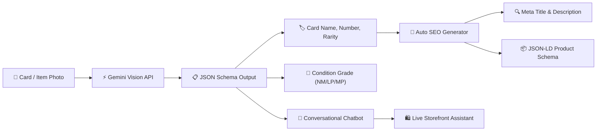

# 🌟 RLG Developer Portfolio & Interactive Architectural Workspace (Frontend)

<p align="center">
  
</p>

<p align="center">
  <strong>Senior Frontend Engineer & Creative UI Architect Portfolio</strong><br />
  A dual-surface developer portfolio featuring a modern light Bento grid UI and an immersive, dark SaaS/DevOps architectural workspace with interactive multi-device simulators, slide deck talk tracks, and autonomous AI automation pipelines.
</p>

<p align="center">
  <a href="https://rlgonlineshop.com" target="_blank">
    
  </a>
  <a href="#-tech-stack--tooling">
    
  </a>
  <a href="#-tech-stack--tooling">
    
  </a>
  <a href="#-tech-stack--tooling">
    
  </a>
  <a href="#-tech-stack--tooling">
    
  </a>
  <a href="#-tech-stack--tooling">
    
  </a>
  <a href="#-ai-pipelines-deep-dive">
    
  </a>
  <a href="#-infrastructure--deployment">
    
  </a>
</p>

---

## 📑 Table of Contents

1. [Architectural Concept & Dual-Surface Experience](#-architectural-concept--dual-surface-experience)
2. [Surface 1: Outer Portfolio (Light Bento Grid)](#-surface-1-outer-portfolio-light-bento-grid)
3. [Surface 2: Inner Project Workspace (Dark DevOps Surface)](#-surface-2-inner-project-workspace-dark-devops-surface)
4. [Interactive Demos & Multi-Device Simulators](#-interactive-demos--multi-device-simulators)
5. [Presentation Deck System (NotebookLM Style)](#-presentation-deck-system-notebooklm-style)
6. [Autonomous Multimodal AI Pipelines](#-autonomous-multimodal-ai-pipelines)
7. [Cloud Infrastructure & Deployment Topology](#-cloud-infrastructure--deployment-topology)
8. [Codebase Architecture & Directory Structure](#-codebase-architecture--directory-structure)
9. [Reactive State Management (Pinia)](#-reactive-state-management-pinia)
10. [Local Development & Setup Guide](#-local-development--setup-guide)
11. [Production Deployment](#-production-deployment)
12. [Developer Bio & Contact](#-developer-bio--contact)

---

## 🏛 Architectural Concept & Dual-Surface Experience

This portfolio is built on a **Dual-Surface UI Paradigm** engineered to solve the traditional developer portfolio paradox: high-level hiring managers want clean, legible overviews and quick metrics, while engineering leads, staff architects, and tech interviewers demand deep dives into architecture, live simulated applications, code quality, and infrastructure topology.

```
┌────────────────────────────────────────────────────────────────────────┐
│                        OUTER PORTFOLIO (Light Bento)                   │
│   • Modern Bento Grid (#f8fafc / #ffffff)                              │
│   • Developer Bio & Availability                                       │
│   • 6-Category Skills, Tooling & Infrastructure Matrix                 │
│   • Featured Project Cards with Live Status Pills                      │
└───────────────────────────────────┬────────────────────────────────────┘
                                    │ Click "Explore Project Workspace"
                                    ▼
┌────────────────────────────────────────────────────────────────────────┐
│                   INNER PROJECT WORKSPACE (Dark DevOps Dashboard)      │
│   • Deep Slate Shell (#090d16 / #0f172a) with Glowing Glass Accents     │
│   • Live Production Header: rlgonlineshop.com | Railway | Namecheap     │
│   • 7-Tab Navigation: Overview | Deck | Demos | Infra | Tech | AI | Arch│
│   • Multi-Device Simulators: Desktop (1440p), Tablet (768p), Mobile    │
│   • NotebookLM Presentation Deck with Talk Track Notes Drawer          │
│   • Interactive Admin Portal & Authentic 13-Section Storefront         │
└────────────────────────────────────────────────────────────────────────┘
```

---

## ☀️ Surface 1: Outer Portfolio (Light Bento Grid)

The outer portfolio delivers an ultra-clean, minimalist Bento Grid design inspired by contemporary modern design systems:

- **Aesthetic & Theme:** Crisp light palette (`#f8fafc` background, `#ffffff` card tiles, `border-slate-200/80` borders, and subtle indigo/violet hover glows).
- **Hero Section:**
  - Status beacon: `Available for Senior Architect roles & consulting`.
  - Developer identity, high-impact headline (*"Bridging Enterprise Frontend Systems & Autonomous AI Pipelines"*), and quick action buttons.
  - Floating metric badges highlighting **7+ Years Experience**, **99.98% Production Uptime**, and **Sub-100ms TTFB**.
- **6-Category Technical Skills & Tooling Matrix:**
  1. **Languages & Core:** PHP 8+, JavaScript (ESNext), TypeScript, HTML5 / Semantic Web, CSS3 & Tailwind CSS.
  2. **Backend Frameworks & DB:** Laravel 11 (Service Layer, Form Requests, Queues), MySQL / Relational DB, Inertia.js, RESTful APIs.
  3. **Frontend & Reactive State:** Vue 3 (Composition API, `<script setup>`), Pinia, Vite, Mobile-First PWA (Service Workers, Capacitor-ready).
  4. **AI & Multimodal Engineering:** Gemini API (Vision OCR, set/condition parsing), Automated SEO Generation (JSON-LD schemas, meta tags), Conversational Storefront Chatbot, Prompt Architecture.
  5. **Cloud & Infrastructure:** Railway Cloud Deployment, Namecheap DNS Routing (Apex A & CNAME records), Redis Caching & Queue Workers, Edge Security / Cloudflare.
  6. **Tooling & Quality DevOps:** Google Antigravity (Autonomous pair programming), Google Jules (Asynchronous PR review), Playwright E2E automation, n8n webhook orchestration.
- **Project Showcase Card:**
  - Live status indicator: `Production 🟢 (rlgonlineshop.com)`.
  - Tech pill badges, feature list, and one-click launch trigger to activate the **Inner Workspace**.

---

## 🌙 Surface 2: Inner Project Workspace (Dark DevOps Surface)

Clicking **"Explore RLG Online Shop"** launches a full-screen, responsive SaaS dashboard crafted with deep slate and purple/cyan cybernetic glows (`#090d16` to `#0f172a`):

### Top Header Bar (`WorkspaceTopBar.vue`)
- **Breadcrumb Trail:** Dynamic hierarchy tracking the current module (`RLG Online Shop > Interactive Demos > Admin Panel`).
- **Global Search:** Quick filter input to search through project modules, slides, and products.
- **Production Status Badges:**
  - `Production: rlgonlineshop.com 🟢` (direct link out to production domain).
  - `Railway Deployed` & `Namecheap DNS` host badges.
  - `AI Services: Online 🟢` live heartbeat indicator.
  - Quick action links for GitHub monorepo and single-click return to Outer Portfolio.

### Left Navigation Sidebar (`WorkspaceSidebar.vue`)
Responsive collapsible sidebar offering 7 dedicated architectural modules:
1. **Overview & Metrics:** High-level executive briefing, monorepo statistics, and system KPIs.
2. **Presentation Deck:** 8-slide presentation system featuring interviewer talk tracks.
3. **Interactive Demos:** Toggle between the live **Admin Panel** and **Buyer Storefront** across Desktop, Tablet, and Mobile device frames.
4. **Infrastructure & Deployment:** Full container specs, Nixpacks build pipelines, and Namecheap DNS configuration.
5. **Tech Stack & Tooling:** Deep-dive inventory of languages, frameworks, linters, and libraries.
6. **AI Pipelines Deep Dive:** Interactive workflow breakdown of Gemini Vision OCR, Auto SEO, and conversational agents.
7. **Architecture & Code Quality:** Service layer design, repository patterns, database schema integrity, and automated testing suites.

---

## 📱 Interactive Demos & Multi-Device Simulators

The **Interactive Demos** module (`AdminPanelDemo.vue`, `BuyerStorefrontDemo.vue`, `DeviceSimulatorFrame.vue`) provides fully functional, simulated environments embedded inside responsive device frames:

### Multi-Device Resolution Frame
- **Desktop Simulator (1440 × 900):** Contained in a sleek browser chassis with URL bar, SSL lock indicator, and internal scroll container (`h-[750px] overflow-y-auto`) ensuring zero layout overflow.
- **Tablet Simulator (768 × 1024):** iPad-style responsive tablet viewport testing mid-screen breakpoints.
- **Mobile Simulator (375 × 812):** High-fidelity iPhone frame complete with realistic Dynamic Island, status bar, and home indicator.
- **Zoom Controls:** Switch between `75%`, `100%`, and `125%` zoom scaling.

### A. Admin Panel Demo (`AdminPanelDemo.vue`)
- **Multimodal AI Vision Intake Engine:**
  - One-click image selection (e.g., Japanese Charizard VSTAR, One Piece Manga Shanks).
  - Simulated **Gemini Vision OCR** parsing Japanese card series, card number, rarity, and centering condition grade in <1.5s.
  - Live progress states: `Image Upload` ➔ `Vision Token Ingestion` ➔ `JSON Schema Extraction`.
- **One-Click Automated SEO & Schema Generator:**
  - Auto-generates long-tail search titles, search slugs, meta descriptions, and Google-ready `Product` + `Offer` JSON-LD schemas.
- **Real-Time Inventory Operations:**
  - Live metrics bar: Total Sales, Active SKUs, Ingestion Speed, AI throughput.
  - Interactive product inventory table with markup toggles, stock adjustments, and status tags.

### B. Buyer Storefront Demo (`BuyerStorefrontDemo.vue`)
Replicates the authentic, full-scale e-commerce storefront of `rlgonlineshop.com` with **13 complete sections**:
1. **Top Announcement Ribbon:** Delivery perks, flash sale countdown, and live customer service notice.
2. **Storefront Navbar:** Logo, search bar, currency switcher (₱ / $), Wishlist counter, Member profile badge, and reactive Cart pill with badge count.
3. **Hero Banner:** *"Build, Collect & Battle. Your Premier Hobby Store."* with Japanese card fan preview, category chips, and dual CTA buttons.
4. **Hobby Categories Grid:** 5 visual tiles (*TCG Cards, Gunpla Model Kits, Anime Scale Figures, Anime Merchandise, Toys & Plushies*).
5. **Promotional Announcement:** *"Follow Us on FB: angaskie — Win Surprise Prizes!"*.
6. **Best Selling Collectibles:** 5-column grid featuring authentic Japanese cards with Near Mint condition badges, star ratings, and instant cart triggers.
7. **Curated Top Picks:** High-tier graded cards and rare expansion boosters.
8. **Collector Welcome Coupon Banner:** 10%–20% Off promotional drop with coupon code `RLGCOLLECTOR`.
9. **New Releases Grid:** Latest Japanese card set drops.
10. **Gunpla & Scale Figures Showcase:** Master Grade / High Grade model kits and pre-painted PVC figures.
11. **Hobby Guides & Articles:** Journal guides on card grading and Gunpla panel lining.
12. **4 Trust Badges:** *100% Authentic Guaranteed*, *Safe Bubble-Wrapped Delivery*, *Fast Dispatch*, *Secure Checkout*.
13. **Full Storefront Footer:** *Hobby Vault*, *Collector Care*, *VIP Club* newsletter subscription, and copyright notice.
- **Interactive Slide-Over Cart Drawer (`CartDrawer.vue`):** Real-time subtotal, coupon application, quantity controls, and mock checkout.
- **Conversational AI Assistant ("Ask Aiko AI" / `AiChatbotWidget.vue`):** Floating chatbot with pre-loaded prompt chips, live catalog recommendation context, and direct cart actions.

---

## 📊 Presentation Deck System (NotebookLM Style)

The **SlideDeckViewer** (`SlideDeckViewer.vue`) replicates a modern Google NotebookLM / Keynote presentation experience:

- **8 Technical Architectural Slides:**
  1. *Executive Overview & Product Architecture*
  2. *Dual-Surface Architecture (Admin Engine vs. Buyer Storefront)*
  3. *Multimodal AI Vision Intake Engine (Gemini API)*
  4. *Autonomous SEO Engine & JSON-LD Schemas*
  5. *Conversational Storefront AI Assistant*
  6. *Cloud Infrastructure on Railway & Namecheap DNS*
  7. *Development Workflow with Google Antigravity & Jules*
  8. *Key Metrics, Business Impact & Technical Takeaways*
- **Interactive Controls:** Previous (`<`) / Next (`>`) arrows, keyboard navigation, slide counter (`Slide X of 8`), and dot indicators.
- **Collapsible "Talk Tracks & Highlight Notes" Drawer:**
  - Provides the exact verbal talk tracks and interview presentation points for each slide.
  - Designed for technical architectural walkthroughs, client pitches, and stakeholder reviews.

---

## 🤖 Autonomous Multimodal AI Pipelines

The portfolio showcases three enterprise-grade AI integration pipelines (`AiPipelinesView.vue`):



1. **Multimodal Vision OCR Engine:**
   - **Model:** Gemini 2.5 Multimodal API.
   - **Function:** Ingests raw camera captures of Japanese trading cards, analyzes Japanese character kanji, set numbers, and rarity stamps, and outputs structured, validated JSON directly into the database draft.
2. **Automated SEO & Schema Generation:**
   - **Function:** Programmatically converts ingested product attributes into high-intent long-tail titles, URL slugs, meta descriptions, and search-indexed `Product` and `Offer` schema microdata.
3. **Conversational E-Commerce Assistant ("Aiko AI"):**
   - **Function:** Context-aware shopping assistant running in a floating drawer, equipped with live catalog knowledge to recommend items, check card conditions, and suggest mystery bundles.

---

## ☁️ Cloud Infrastructure & Deployment Topology

Detailed in `DeploymentView.vue`, the production deployment for `rlgonlineshop.com` utilizes a resilient, modern cloud topology:

```
┌────────────────────────────────────────────────────────┐
│                   Namecheap DNS                        │
│   • Apex Domain A-Record: 35.xxx.xxx.xxx               │
│   • CNAME Record: www.rlgonlineshop.com                │
└───────────────────────────┬────────────────────────────┘
                            │ HTTPS / TLS Termination
                            ▼
┌────────────────────────────────────────────────────────┐
│                   Railway Cloud                        │
│   • Nixpacks Container Build Pipeline                  │
│   • Zero-Downtime Continuous Git Deployments           │
│   • Multi-Service Cluster:                             │
│     ├── Laravel 11 Web & API Service                   │
│     ├── MySQL 8.0 Managed Database                     │
│     └── Redis In-Memory Cache & Queue Workers          │
└────────────────────────────────────────────────────────┘
```

- **Domain & DNS Management:** Managed via Namecheap DNS, routing traffic to Railway's global edge network with automated SSL/TLS provisioning.
- **Containerization & CI/CD:** Built using Railway Nixpacks containers; every commit pushed to the monorepo triggers automatic builds, test validation, and zero-downtime rollouts.
- **Asynchronous Processing:** Redis-backed queue workers process intensive background tasks (image optimization, AI vision intake calls, and webhook dispatches).

---

## 📂 Codebase Architecture & Directory Structure

```
frontend/
├── package.json                    # Dependencies & Scripts
├── vite.config.js                  # Vite Build Configuration
├── tailwind.config.js              # Tailwind Design System Configuration
├── postcss.config.js               # PostCSS Autoprefixer Configuration
├── index.html                      # HTML Entrypoint
└── src/
    ├── App.vue                     # Root Application Component
    ├── main.js                     # Application Entrypoint (Vue + Pinia)
    ├── style.css                   # Global Tailwind Styles & Custom Animations
    ├── assets/                     # Static Graphics & SVGs
    │   ├── hero.png                # Hero Banner
    │   ├── vue.svg                 # Vue Logo
    │   └── vite.svg                # Vite Logo
    ├── components/
    │   ├── portfolio/              # Surface 1: Outer Portfolio Components
    │   │   ├── PortfolioNavbar.vue     # Top Navigation Bar & Brand
    │   │   ├── HeroSection.vue         # Hero Banner, Metrics & CTAs
    │   │   ├── BentoGrid.vue           # Modern Bento Grid Layout
    │   │   ├── SkillsMatrix.vue        # 6-Category Technical Matrix
    │   │   ├── ProjectShowcaseCard.vue # Interactive Project Cards
    │   │   └── PortfolioFooter.vue     # Footer with Social Links
    │   └── workspace/              # Surface 2: Inner Project Workspace
    │       ├── WorkspaceShell.vue      # Full-Screen Dashboard Layout
    │       ├── WorkspaceTopBar.vue     # Header Bar with Badges & Search
    │       ├── WorkspaceSidebar.vue    # 7-Tab Navigation Sidebar
    │       ├── SlideDeckViewer.vue     # NotebookLM Slide Deck & Talk Tracks
    │       ├── DeploymentView.vue      # Railway & Namecheap Cloud Specs
    │       ├── TechStackView.vue       # In-Depth Tooling Breakdown
    │       ├── AiPipelinesView.vue     # Multimodal AI Workflow Diagram
    │       ├── ArchitectureView.vue    # Monorepo & Code Quality Architecture
    │       └── demos/                  # Interactive Simulators
    │           ├── DeviceSimulatorFrame.vue # Responsive Device Frame (Desktop/Tablet/Mobile)
    │           ├── AdminPanelDemo.vue       # Simulated Merchant Intake & SEO Suite
    │           ├── BuyerStorefrontDemo.vue  # Authentic 13-Section Japanese TCG Storefront
    │           ├── CartDrawer.vue           # Reactive Shopping Cart Slide-Over
    │           └── AiChatbotWidget.vue      # Floating "Ask Aiko AI" Assistant
    ├── data/
    │   └── projectsData.js         # Centralized Data Matrix (Bio, Skills, Slides, SKUs)
    └── stores/
        ├── portfolioStore.js       # Core UI Navigation, Tab & Device State
        ├── cartStore.js            # Reactive E-Commerce Cart & Total Calculations
        └── inventoryStore.js       # Product Catalog, Stock Levels & AI Ingestion State
```

---

## ⚡ Reactive State Management (Pinia)

The application utilizes three modular Pinia stores to guarantee clean separation of concerns:

| Store | Location | Primary Responsibilities |
| :--- | :--- | :--- |
| **`usePortfolioStore`** | `src/stores/portfolioStore.js` | Manages surface modes (`outer` vs. `workspace`), active workspace tab, device simulator resolution (`desktop`, `tablet`, `mobile`), zoom scaling, slide index, talk tracks visibility, search queries, and currency (`PHP` vs. `USD`). |
| **`useCartStore`** | `src/stores/cartStore.js` | Handles shopping cart state, item additions/removals, quantity adjustments, discount calculations, tax/shipping totals, and drawer toggling. |
| **`useInventoryStore`** | `src/stores/inventoryStore.js` | Manages mock catalog items, simulated Gemini Vision OCR intake execution, AI-generated SEO drafts, category filters, and inventory counts. |

---

## 🚀 Local Development & Setup Guide

### Prerequisites
- **Node.js:** v18.0.0 or higher (v20+ recommended)
- **Package Manager:** `npm` (v9+) or `pnpm` / `yarn`

### Installation Steps

1. **Install Dependencies:**
   ```bash
   npm install
   ```

2. **Start the Vite Development Server:**
   ```bash
   npm run dev
   ```
   The application will start locally at **`http://localhost:5173/`** with instant Hot Module Replacement (HMR).

---

## 📦 Production Deployment

To generate an optimized production bundle:

```bash
npm run build
```

The compiled assets will be output to the `dist/` directory, optimized with code-splitting, CSS minification, and tree-shaking:
- `dist/index.html`
- `dist/assets/*.css`
- `dist/assets/*.js`

To preview the production build locally:
```bash
npm run preview
```

---

## 👨‍💻 Developer Bio & Contact

- **Role:** Senior Frontend Engineer & Creative UI Architect
- **Specialization:** Vue 3 (Composition API), Enterprise Laravel Monorepos, High-Performance UI Systems, Autonomous Multimodal AI (Gemini Vision OCR).
- **Production Storefront:** [https://rlgonlineshop.com](https://rlgonlineshop.com)
- **Location:** Manila / Remote Worldwide
- **Status:** Available for Senior UI Architect roles, technical consulting, and enterprise front-end engagements.

---

<p align="center">
  <sub>Engineered with precision using Vue 3, Vite, Tailwind CSS, Pinia, and Google Antigravity. © 2026 RLG. All rights reserved.</sub>
</p>
